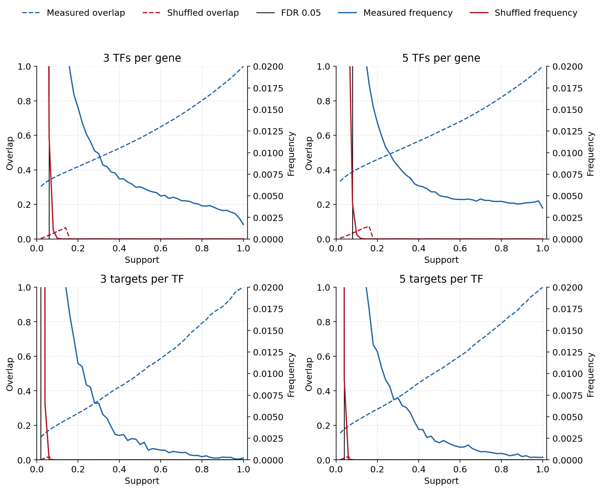
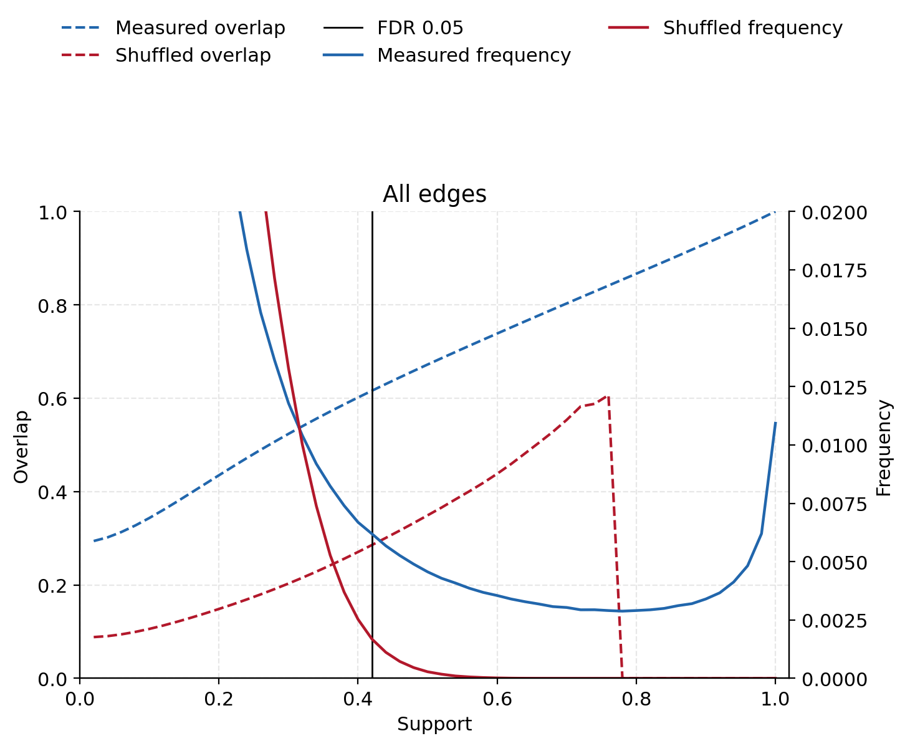

# NestBoot on the SCENIC+ runs

This note follows Morgan et al., Bioinformatics 35:1026–1032 (2019). NestBoot, at one sparsity, is:

1. Infer the network Q times on bootstrap resamples of the measured data, and Q times on an experiment-wise shuffle.
2. A link’s support is the fraction of the Q inferences that contain it.
3. Equation 1 picks the smallest support cutoff B such that

FDR(B) = (shuffled links with support > B) / (measured links with support > B)

is at most 0.05.
4. The consensus is every link with support greater than B. If this inner loop is itself repeated for R outer runs, a link must clear B in every outer run. That extra rule is why the FDR in the paper’s Figure 6 is lower than the rate requested in Equation 1.

## What these 50 runs are

Each run is one GRNBoost2 seed on a fixed multiome, not a resample of experiments. The null shuffles each gene’s expression across cells on its own, rather than shuffling whole experiments. Region-to-gene links, cistromes, and the ranking database are held fixed. Seeds are `42 + run` for the measured data and `42 + run + 10000` for the shuffle.

Read as NestBoot, this is **one outer run (R = 1) with Q = 50 inner inferences**. There is no second loop, so step 4 stops at “support greater than B.” The FDR is the Equation 1 value, not the more conservative rate that comes from demanding the same cutoff in 100 outer runs.

The paper aims for about 3 links per node. Self-links are removed before that cut. GRNBoost2 ranks a TF predicting itself first in every run, measured and shuffled, because the two expression columns are the same vector. The gene shuffle does not break that edge. Those 700 edges are not regulatory links, and they were the spike at support 50 in the earlier weight-ranked plots.

Two directed readings of “3 links per node” are reported. Both use the top 3 edges by GRNBoost2 importance inside each run.

## 3 regulators per gene

Each gene keeps its 3 strongest TFs. That is 87,495 edges in every run.

Equation 1 first falls to 0.05 at **B = 0.06**, which means the link is present in **at least 4 of 50** seeds.

| Support greater than | Measured links | Shuffled links | FDR |
|---:|---:|---:|---:|
| 0 (seen at least once) | 551,565 | 3,828,642 | 6.94 |
| 2/50 | 270,227 | 48,828 | 0.181 |
| **3/50 (the cutoff)** | **230,264** | **4,069** | **0.018** |
| 4/50 | 203,680 | 288 | 0.0014 |
| 6/50 | 168,861 | 1 | 6×10⁻⁶ |
| 7/50 | 156,133 | 0 | 0 |
| 40/50 | 19,494 | 0 | 0 |
| 50/50 | 924 | 0 | 0 |

The consensus at FDR 5% is those 230,264 measured links. It is a large union across seeds, not the 87,495 edges of any single run. Past support 7/50 the shuffle contributes nothing. 924 links are in every seed.

### Link frequency and Equation 1

Blue is 3 regulators per gene. Orange is 3 targets per TF. Solid lines are measured, dashed lines are shuffled. The left panel is the number of links at each support, on a log scale, which is the frequency curve in the paper’s Figure 2. The right panel is Equation 1. The dotted horizontal line is FDR 0.05. A point marks the first B at which each curve is at or below that line. Shuffled links no longer pile up at support 1.0, because the self-links that produced that spike have been removed.

## 3 targets per TF

Each TF keeps its 3 strongest targets after the self-link is dropped. That is 2,100 edges in every run. This is the much sparser reading of the same phrase.

Equation 1 first falls to 0.05 at **B = 0.02**: the link is present in **at least 2 of 50** seeds.

| Support greater than | Measured links | Shuffled links | FDR |
|---:|---:|---:|---:|
| 0 (seen at least once) | 27,570 | 104,309 | 3.78 |
| **1/50 (the cutoff)** | **13,775** | **683** | **0.050** |
| 2/50 | 9,525 | 8 | 0.0008 |
| 3/50 | 7,319 | 0 | 0 |
| 40/50 | 80 | 0 | 0 |
| 50/50 | 6 | 0 | 0 |

Seen twice is enough. One step further, support greater than 3/50, the shuffled count is already zero and 7,319 measured links remain. Only 6 of those links are in every seed. The top targets of a TF are not a stable network across GRNBoost2 seeds. They are stable enough that the shuffle does not reproduce them once the self-link is gone.

## Figure 2: frequency and overlap

Same two graphs as above. The two degree-3 cuts are one edge set here. In each run a link is kept if it is one of the gene’s 3 strongest TFs or one of the TF’s 3 strongest other targets. That adds only about 15 edges to the 87,495-edge gene graph, because nearly every top target of a TF is already among that gene’s top 3 regulators. The x-axis is support. The left axis is overlap, fixed at 0–1 (dashed). The right axis is frequency, zoomed to 0–0.02 (solid). Blue is measured, red is shuffled. The black line is the Equation 1 cutoff, support 0.06.

At 3 regulators per gene the runs already agree more than the shuffle before any cutoff: overlap 0.30 versus 0.003. Raising the cutoff lifts the measured overlap and wipes out the shuffled one. Overlap is 0.58 at support 0.5 and 0.80 at support 0.8. It reaches 1 only at support 1, where every remaining link is in every run, so the 50 restricted networks are identical. Shuffled overlap is 0 from support 0.2 upward, because no shuffled link is in 10 or more runs.

At 3 targets per TF the measured networks agree less to begin with (overlap 0.13, against 0.0001 for the shuffle). The same pattern holds, just lower: overlap 0.50 at support 0.5 and 0.79 at support 0.8. Shuffled overlap is already 0 at support 0.08. The frequency curves explain why Equation 1 can sit at a low cutoff: almost all shuffled links are in one run (99% of them at 3 targets per TF; 87% at 3 regulators per gene), while the measured links are spread toward higher support.

The curves are in `fig2_support_frequency_overlap.tsv`.

### 3–5 links per node, and every edge

The 2×2 is degrees 3 and 5 only. The top row is regulators per gene. The bottom row is targets per TF. The second figure is every TF–gene edge GRNBoost2 wrote, with no degree cut. Both show link frequency only. Blue is measured, red is shuffled, and the black line is that panel’s Equation 1 cutoff. The y-axis runs from 0 to 0.2. The one-run peak sits above that frame. Each point is the raw fraction of links at that support (1/50, 2/50, …). The curves are not smoothed. The line only joins those points. Self-links are removed. The values are in `fig2_degree_and_full.tsv`.

| Graph | Edges scale | Cutoff | Measured links above it | Shuffled links above it | FDR | Shuffled frequency is 0 from |
|---|---:|---:|---:|---:|---:|---:|
| 3 TFs per gene | 87,495 | 0.06 | 230,264 | 4,069 | 0.018 | 0.16 |
| 4 TFs per gene | 116,660 | 0.06 | 296,611 | 11,917 | 0.040 | 0.16 |
| 5 TFs per gene | 145,825 | 0.08 | 320,337 | 3,391 | 0.011 | 0.18 |
| 3 targets per TF | 2,100 | 0.02 | 13,775 | 683 | 0.050 | 0.08 |
| 4 targets per TF | 2,800 | 0.04 | 12,326 | 12 | 0.001 | 0.08 |
| 5 targets per TF | 3,500 | 0.04 | 15,111 | 19 | 0.001 | 0.08 |
| All edges | ~2.4 million | 0.42 | 1,566,575 | 55,314 | 0.035 | 0.78 |

On the degree-limited panels the red frequency line only passes through the 0–0.02 window for a short stretch, then sits on zero. Measured overlap at support 0.5 is about 0.50–0.62, and shuffled overlap there is 0. The unthresholded table is the one where the shuffled tail stays inside the window: shuffled frequency is still positive until support 0.78, and shuffled overlap at support 0.5 is still 0.35 against 0.67 for the measured runs. Keeping every edge is what lets null links recur. Cutting to a few links per node removes that tail.

## What this is not

Earlier tables also swept GRNBoost2 rank cutoffs and split the 50 seeds into groups (`sparsity_fdr.tsv`, `inner_bootstrap_fdr.tsv`). The NestBoot result for this chapter is Equation 1 on the degree cuts and on all edges, in the figures above.

In particular, “seen in at least 2 of 50 eRegulon runs” is Equation 1 applied to SCENIC+’s own triplet filter, which keeps about 19,000 TF–gene links per run rather than 3 links per node. And splitting the 50 seeds into 5×10 or 10×5 does not create the paper’s outer loop. An outer run would resample the experiments, re-shuffle experiment-wise, and repeat the inner Q inferences. That was not done.

The full curves are `eq1_3per_gene.tsv` and `eq1_3per_tf.tsv`.
